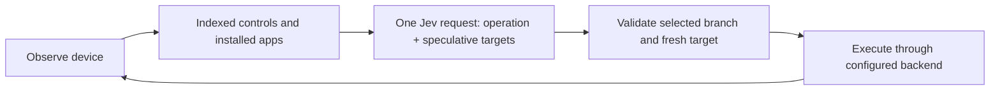

# Mobile Jev

[](https://github.com/droidrun/mobile-jev/blob/main/docs/media/uber-demo.mp4)

**[▶ Watch the demo](https://github.com/droidrun/mobile-jev/blob/main/docs/media/uber-demo.mp4)** — Jev opens Uber, enters a route from San Francisco Airport to the Golden Gate Bridge, and reaches payment selection. The recorded task timer shows about **21 seconds for 9 actions**. A completed booking is not demonstrated.

A standalone mobile agent for one explicitly selected local ADB device, powered by [TypeSafe's Jev](https://docs.typesafe.ai/). Includes a live React studio, a CLI, execution traces, and request-level latency measurements.

[TypeSafe](https://typesafe.ai) · [Jev docs](https://docs.typesafe.ai) · [Demo guide](docs/DEMO.md)

## Run it

Requirements: **Node.js 24 recommended** (22.16+ supported), **pnpm 10.30.1**, Android platform-tools, a ready Android device, and a TypeSafe API key. Tested locally on macOS; CI runs offline tests and the build on Linux.

```sh
git clone https://github.com/droidrun/mobile-jev.git
cd mobile-jev
corepack enable
pnpm install --frozen-lockfile
cp .env.example .env.local
```

Add `ADB_SERIAL` and `TYPESAFE_API_KEY` to `.env.local`, with platform-tools installed and exactly one device connected:

```sh
ADB_SERIAL=emulator-5554
```

```sh
pnpm doctor
pnpm dev
```

Open **http://127.0.0.1:3040**. Enter a goal and press **Run task**.

- Get a TypeSafe key from the [TypeSafe console](https://console.typesafe.ai/).
- Connect your own Android device over ADB. The serial must name one already-connected device; the adapter never selects a device.

Already export your variables? That works too. Exported variables take precedence over `.env.local`, which takes precedence over `.env`.

`pnpm doctor` checks readiness, the UIAutomator observation, and app inventory without mutating the device. The CLI accepts `--adb-serial emulator-5554`. ADB text is intentionally limited to letters, numbers, spaces, and `. _ @ + : -`; unsupported text fails before dispatch. Studio shows a same-origin PNG snapshot every 500 ms and disables browser device controls.

## Included demo: enable dark theme

Ask **“Turn on dark theme in Android Settings.”** Jev discovers Settings from the device's available apps, opens it over ADB, selects the relevant controls, and changes the setting. The demo runner reads the screen again and verifies the actual Dark theme switch is on; it does not accept a model DONE response as proof.

```sh
pnpm demo dark-theme --reset
```

`--reset` first asks Jev to establish and verify an off baseline. Setup, task execution, and verification have separate timings. Every attempt is retained locally, including failures. This is a small reproducible utility demo without accounts, purchases, or travel-app loading. See [what the demo does and its limits](docs/DEMO.md).

### Verify a change on the phone

```sh
pnpm verify                # four tasks, about forty seconds
pnpm verify --repeat 3     # repeat them, to see variance
```

Each case resets its own preconditions, runs the task, then checks the device itself: a system setting for the two settings tasks, the brightness value for the slider tasks, and a run that starts with the screen asleep. The device decides the outcome; a run that reached the asked-for state without recognising it reports that beside the pass.

## The studio

- A read-only ADB snapshot of the live device, refreshed every 500 ms.
- Goal input, executed-action timeline, model latency, and a task clock that stops on completion, failure, or cancellation.
- Stop control, reconnect, fullscreen, and recent runs. Clear removes finished runs and resets the timer. One task owns the configured device at a time.
- The desktop workspace fits in one viewport; activity scrolls inside its panel.

The account API keys stay on the server. The studio exposes a same-origin screenshot route and no device controls. The app binds to localhost, validates request origins, and is intended for a single local operator. Public/multi-user hosting requires your own authentication and device authorization. Recent runs are held in memory and cleared on server restart.

## Use the CLI

```sh
# Preview the next decision, without executing it:
pnpm agent run "Turn on dark theme in Android Settings."

# Execute a goal and retain the real model decisions:
pnpm agent run "Turn on dark theme in Android Settings." \
  --execute --steps 20 --trace artifacts/dark-theme.jsonl

# Inspect a phone or measure the API:
pnpm agent observe
pnpm agent screenshot
pnpm agent profile --out artifacts/api-profile.json

# Direct controls for debugging:
pnpm agent tap 300 500
pnpm agent type "San Francisco" --clear
pnpm agent back
```

Use `--adb-serial SERIAL` to select the device. `pnpm agent --help` lists all options. Traces and screenshots are ignored by git and never overwrite an existing file.

## How Jev drives it



Jev chooses `OPEN_APP`, `TAP`, `TYPE_TEXT`, scrolling, navigation, `WAIT`, `DONE`, or `BLOCKED`. Operation and compatible-target questions share one request; unused target answers cannot execute. App launch targets come from the configured device inventory. When a goal names available apps explicitly, exact name matching narrows that inventory; otherwise up to 200 apps are offered and the launcher remains available.

The executor resolves coordinates from observed bounds. It validates probability distributions, rejects stale targets, and never retries a device mutation after an uncertain transport failure. It records actions before the next observation, so a failed read cannot erase an executed action.

Text comes from exact spans in the goal. Jev selects a span; code copies it into the field. Supply `--text "exact field value"` to override those candidates. This implementation does not generate arbitrary prose or invent missing personal details. A separate text-generation model is not needed.

Text replacement returns a read-back receipt when the focused field can be identified. The agent verifies the complete field value in its next observation before asking Jev to continue; an unverified value stops the run without retyping.

Confidence is visible and an optional `--confidence` cutoff is available. **Jev's DONE response is not independent proof of success.** Check the resulting device state, especially for numeric values, dates, and multi-part goals. The demo runner provides task-specific verification; see [the demo guide](docs/DEMO.md).

## Speed and reproducibility

The model transport reuses its HTTPS connection. Device readiness is cached briefly. The loop observes immediately after actions, with bounded polling for transitions, rather than sleeping after every interaction. Jev still chooses every operation; there are no prepared tap sequences in the policy.

Request timings split DNS, TCP/TLS, response wait, and download from total wall time. Response wait includes network, server, and device work—not just server processing. A 300 ms swipe also includes its requested gesture duration. See [the demo guide](docs/DEMO.md) for measurement boundaries, successes, and failures.

An identical prompt is not guaranteed to produce an identical trace. App version, locale, current screen, account state, network, and model version affect results. `jev-latest` is convenient; set `TYPESAFE_MODEL` to a supported fixed version when comparing runs, and retain the returned model name in the trace.

## Development

```sh
pnpm check       # tests, lint, typecheck, formatting, production build
pnpm build
pnpm start      # production studio on localhost:3040
```

CI requires no API keys and does not control a phone. Live `run --execute` and demo commands make real model/device requests.

What changed on the phone side, and the measurement behind each change: [docs/CHANGES-mobile.md](docs/CHANGES-mobile.md).

| Directory               | Purpose                                                         |
| ----------------------- | --------------------------------------------------------------- |
| `scripts/mobile-agent/` | Device adapter, Jev policy, executor, transports, CLI and tests |
| `apps/jev-studio/`      | Next.js studio, device snapshot route, SSE and task lifecycle   |
| `scripts/doctor.mjs`    | Configuration and device connectivity checks                    |
| `scripts/demo.mjs`      | Repeatable demo and outcome verification                        |
| `scripts/verify.mjs`    | Four live tasks, checked against the device                     |
| `artifacts/`            | Local-only traces, screenshots and measurements                 |

MIT licensed; dependencies retain their respective licenses.
